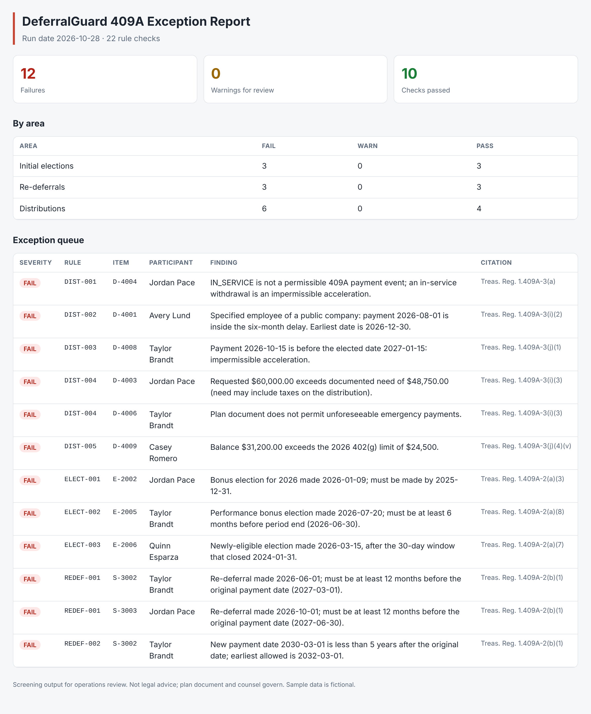
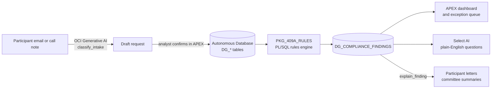

# DeferralGuard

**Section 409A compliance screening for nonqualified deferred compensation plans, built on Oracle Autonomous Database, Oracle APEX and OCI Generative AI.**

NQDC plans carry real tax risk. A late deferral election, a payment to a specified employee inside the six-month delay, or an emergency withdrawal larger than the documented need can trigger immediate income inclusion, a 20% additional tax and interest for the participant. Most of these errors are operational, not legal, and they are catchable with the right data checks before money moves.

DeferralGuard runs those checks. It screens every deferral election, re-deferral and distribution request against the 409A timing and payment rules, puts exceptions in a work queue, and uses generative AI only where it helps people: turning participant emails into structured requests and explaining findings in plain language.



## What it checks

| Code | Rule | Regulation |
|---|---|---|
| ELECT-001 | Salary/bonus deferral elected before the service year | Treas. Reg. 1.409A-2(a)(3) |
| ELECT-002 | Performance-based bonus elected 6+ months before a 12+ month period ends | 1.409A-2(a)(8) |
| ELECT-003 | Newly-eligible participant elects within 30 days | 1.409A-2(a)(7) |
| REDEF-001 | Re-deferral made at least 12 months before the original payment date | 1.409A-2(b)(1) |
| REDEF-002 | Re-deferral pushes payment out at least 5 years | 1.409A-2(b)(1) |
| DIST-001 | Payment is on a permissible event (no in-service withdrawals) | 1.409A-3(a) |
| DIST-002 | Specified employees of public companies wait six months after separation | 1.409A-3(i)(2) |
| DIST-003 | Fixed-date payments are not accelerated | 1.409A-3(j)(1) |
| DIST-004 | Unforeseeable emergency payments are limited to documented need | 1.409A-3(i)(3) |
| DIST-005 | De minimis cash-outs stay within the 402(g) limit and end the entire interest | 1.409A-3(j)(4)(v) |
| DIST-006 | Change-in-control payments are allowed by the plan document | 1.409A-3(i)(5) |
| DIST-007 | Payment falls within the designated-date grace window | 1.409A-3(d) |
| DIST-008 | Requested amount does not exceed the account balance | Recordkeeping control |

## Architecture



**Design principle:** deterministic rules make every pass/fail decision. The model never decides eligibility; it drafts intake and explanations, and a person confirms both.

| Layer | Oracle component | Where |
|---|---|---|
| Data | Autonomous Database (19c / 23ai) tables, constraints, identity columns | `db/01_schema.sql` |
| Rules | PL/SQL package `PKG_409A_RULES`, nightly `DBMS_SCHEDULER` job | `db/03_pkg_409a_rules.sql` |
| UI | APEX dashboard, interactive grid work queue, participant drill-down | `db/04_views_apex.sql`, `apex/README.md` |
| AI in the database | Select AI profile on OCI Generative AI (`DBMS_CLOUD_AI`) | `db/05_select_ai.sql` |
| AI service | OCI Generative AI chat (Llama 3.3 70B on demand) via the OCI Python SDK | `deferral_guard/genai.py` |
| Reference engine | Python mirror of the rules, unit tested in CI | `deferral_guard/rules.py`, `tests/` |

The Python engine and the PL/SQL package use the same rule codes, date math and messages, so a run in the database reconciles with a run in CI.

## Quick start (no cloud account needed)

```bash
git clone https://github.com/RTorres1980/deferral-guard.git
cd deferral-guard
pip install pytest
pytest -q                                   # 27 tests
python -m deferral_guard run --data data/sample --out reports
python -m deferral_guard classify "We have \$60,000 in medical bills after a hospital stay; documented need is \$48,750."
```

`reports/exception_report.html` is the exception report shown above. Without OCI credentials, the AI features use an offline keyword provider so everything runs locally.

## Deploy to Oracle Autonomous Database

1. Create an Always Free Autonomous Database and a schema user `DG`.
2. In Database Actions > SQL (or SQLcl), run `db/01` through `db/04`, then `db/06_sample_data.sql`.
3. Run the rules:
   ```sql
   DECLARE l_run NUMBER; BEGIN l_run := pkg_409a_rules.run_all; END;
   /
   SELECT severity, COUNT(*) FROM v_dg_findings_detail GROUP BY severity;
   ```
4. Optional: set up Select AI with `db/05_select_ai.sql`, then
   `SELECT AI narrate which specified employees have open distribution failures;`
5. Build the APEX app from `apex/README.md` (every page is a declarative region over a view).

To load from Python instead: `pip install oracledb`, set `DG_DB_USER`, `DG_DB_PASSWORD` and `DG_DB_DSN`, then `python scripts/load_to_adb.py --run-rules`.

### OCI Generative AI

```bash
pip install oci
export OCI_GENAI_COMPARTMENT_ID=ocid1.compartment.oc1..xxxx
export OCI_GENAI_REGION=us-chicago-1          # a region with Generative AI
python -m deferral_guard run --explain        # adds plain-language explanations
```

Credentials come from the standard `~/.oci/config`. Never commit keys or OCIDs.

## Sample data

`data/sample` holds two fictional plan sponsors and seven fictional participants, seeded with twelve deliberate errors (late elections, a short re-deferral, a specified employee paid too early, an emergency request above need, an in-service withdrawal and more). `tests/test_rules.py::test_sample_dataset_expected_exceptions` asserts the engine finds exactly those twelve.

## Limitations

- Screens operational timing and payment rules; it does not review plan document language, aggregation across multiple plans, or 409A valuation of equity.
- 402(g) limits must be updated each year in `LIMIT_402G` and `DG_LIMIT_402G`.
- Not legal or tax advice. The plan document and plan counsel govern.

## About

Built by Robert Torres, drawing on 15+ years in wealth management and retirement plan operations, including NQ plan administration, participant distributions and ERISA/IRS compliance. Oracle certifications: Autonomous Database Professional, Generative AI Professional, AI Foundations, Cloud & AI, APEX Foundations.

MIT licensed.
